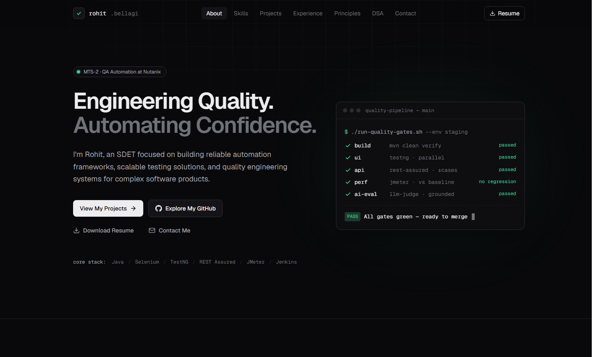
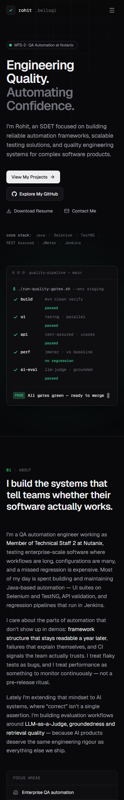

# Rohit D Bellagi — Senior SDET Portfolio

Personal portfolio of **Rohit D Bellagi**, Senior SDET / QA Automation Engineer.
It covers automation framework design, UI and API testing, performance engineering, CI/CD and AI evaluation.



<details>
<summary>Mobile view</summary>



</details>

## Tech stack

| Concern    | Choice                                    |
| ---------- | ----------------------------------------- |
| Framework  | React 19 + TypeScript                     |
| Build tool | Vite                                      |
| Styling    | Tailwind CSS v4 (design tokens in `src/index.css`) |
| Animation  | Framer Motion (subtle, respects `prefers-reduced-motion`) |
| Icons      | Lucide                                    |
| Linting    | Oxlint                                    |

## Project structure

```
src/
├── data/                 ← ALL site content lives here (edit these, not components)
│   ├── profile.ts        ← name, email, GitHub / LinkedIn / LeetCode links, resume path
│   ├── skills.ts         ← skill categories + qualitative levels (no percentages)
│   ├── projects.ts       ← projects, status (planned | in-progress | completed), repo links
│   ├── experience.ts     ← current role and focus areas
│   ├── principles.ts     ← engineering principles
│   ├── dsa.ts            ← DSA topics + problem-solving approach
│   └── types.ts
├── components/
│   ├── layout/           ← Navbar, Footer
│   ├── sections/         ← Hero, About, Skills, Projects, Experience, Principles, ProblemSolving, Contact
│   └── ui/               ← Section, Reveal, ButtonLink, Tag, StatusBadge, BrandIcons
├── hooks/useActiveSection.ts
├── App.tsx
└── index.css             ← Tailwind + design tokens
public/
├── favicon.svg
├── robots.txt
└── resume/               ← put Rohit_D_Bellagi_Resume.pdf here
```

## Getting started

**Prerequisite:** Node.js 20.19+ or 22.12+.

```bash
npm install
npm run dev        # http://localhost:5173
```

| Script            | What it does                         |
| ----------------- | ------------------------------------ |
| `npm run dev`     | Start the dev server with hot reload |
| `npm run build`   | Type-check and build to `dist/`      |
| `npm run preview` | Serve the production build locally   |
| `npm run lint`    | Lint with Oxlint                     |

## Personalising before you publish

1. **Links and email.** Replace the `TODO` placeholders in `src/data/profile.ts`.
2. **Resume.** Add your PDF at `public/resume/Rohit_D_Bellagi_Resume.pdf`.
3. **Project status.** As work progresses, set each project's `status` in `src/data/projects.ts` to `'in-progress'` or `'completed'`, and add `repoUrl`. The "View repository" button appears automatically.
4. **Skill levels.** Adjust `level` (`daily` / `working` / `learning`) in `src/data/skills.ts` to match your own assessment.
5. **Experience dates.** Set `period` in `src/data/experience.ts`.

No environment variables are required. The site is fully static.

## Deploying to GitHub Pages (free)

A workflow at `.github/workflows/deploy.yml` lints, builds and deploys the site on every push to `main`.

1. Create a new **public** repository on GitHub. Name it either:
   - `<your-username>.github.io` → site at `https://<your-username>.github.io/`, or
   - `rohit-sdet-portfolio` → site at `https://<your-username>.github.io/rohit-sdet-portfolio/`

   The workflow detects which one you chose and sets the correct base path automatically.
2. Push the code (see the commands below).
3. In the repository, open **Settings → Pages**. Under **Build and deployment → Source**, choose **GitHub Actions**.
4. Open the **Actions** tab and wait for "Deploy to GitHub Pages" to go green. The site URL appears on the run.

**Custom domain (e.g. `rohit.sudofolks.com`):** add the domain in **Settings → Pages → Custom domain**, create the DNS `CNAME` record your provider asks for, and add a repository variable `BASE_PATH` set to `/` (**Settings → Secrets and variables → Actions → Variables**).

## Deploying to Vercel (alternative)

1. Push the repository to GitHub:
   ```bash
   git init
   git add .
   git commit -m "Initial portfolio"
   git branch -M main
   git remote add origin https://github.com/<your-username>/rohit-sdet-portfolio.git
   git push -u origin main
   ```
2. Go to [vercel.com/new](https://vercel.com/new) and import the repository.
3. Vercel auto-detects Vite. The defaults are correct:
   - Build command: `npm run build`
   - Output directory: `dist`
4. Click **Deploy**. Every push to `main` then redeploys automatically.

## Design principles

- Dark, minimal and typography-led, in the spirit of Linear, Vercel and Stripe.
- Uses one accent colour, the green of a passing test. Amber marks work in progress.
- Content is honest by design: no invented metrics, no percentage skill bars, and project status is shown explicitly.
- Accessible: skip link, semantic landmarks, keyboard-navigable project tabs, visible focus rings, and reduced-motion support.
